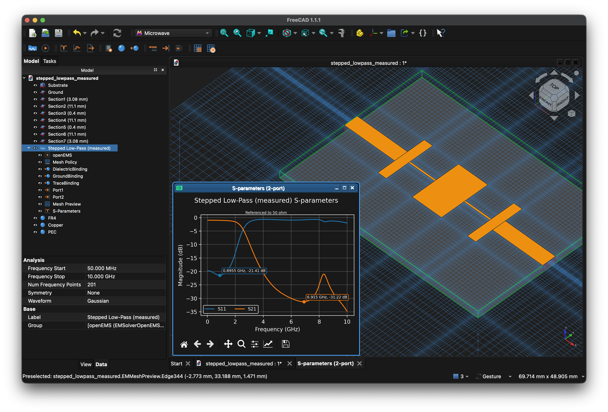

# Microwave Workbench

[](https://github.com/mishka-zz/freecad-microwave/actions/workflows/tests.yml)

A FreeCAD workbench for high-frequency electromagnetic simulation and
design.

Model high-frequency RF devices in FreeCAD, assign materials and boundary
conditions, define ports, configure solver settings, and run simulations.
Extracted S-parameters (`EMSParameters`) are stored directly in the FreeCAD
document database and can be plotted, analyzed via TDR, or exported to
Touchstone format. A Touchstone file read in through **File > Import** is drawn
and compared beside them.

Target applications include antennas, planar and waveguide filters,
couplers, transmission lines, transitions, packaging, cavities, and EMC
shielding.

Status: developer preview.

**Upgrading.** A document saved by an earlier version of the workbench is not
upgraded. Before a run reads a study, the run compares each object
it reads with an object of the same kind made by this build, and refuses the
study where an object lacks a property, offers other choices or holds a
property as another type. The refusal names each such object. Make each object
it names anew, as
[A document saved by an earlier build](docs/running.md#a-document-saved-by-an-earlier-build)
describes.



## Architecture

- **Document-centric model**: Geometry, materials, ports, excitation, and
  mesh policies are represented as native FreeCAD document objects
  (`App::FeaturePython`), independent of specific solver implementations.
- **Pluggable solver adapters**: Each backend adapter validates models
  against its capabilities, generates native solver inputs, executes
  simulations in a subprocess, and parses results back into document
  objects.
- **Standardized results**: Extracted network parameters (`EMSParameters`)
  use standard scikit-rf substrates for plotting, time-domain
  reflectometry (TDR), and Touchstone export.

## Solvers

| Solver | Numerical Method | Status | Target Applications |
|---|---|---|---|
| **openEMS** | FDTD (Time Domain) | **Supported** | Broadband sweeps, planar circuits, 3D structures |
| **Palace** | FEM (Frequency Domain) | **Supported** | Curved geometry on a conforming mesh, waveguide and planar devices through lumped and waveguide ports |
| **NEC2** | Method of Moments (Wires) | Considered | Wire antennas, thin-wire arrays |
| **scuff-em** | Surface Integral (MoM) | Considered | Planar conductors with implicit substrates, periodic structures |
| **FasterCap + FastHenry** | Boundary Element (BEM) | Considered | Quasistatic RLCG extraction for SPICE interconnect models |
| **OpenParEM2D** | 2D FEM | Considered | 2D transmission line cross-section analysis and impedance synthesis |

## Simulation Results and Metrics

| Result Type | Description | Status |
|---|---|---|
| **S-parameters** | Full $N \times N$ matrix versus frequency, normalized to fixed $Z_0$ or modal impedance; Touchstone export (`.sNp`). On Palace a waveguide port is referenced to its own mode, and a lumped port to its `Resistance` | **Supported** |
| **Impedance profile (TDR)** | Step response reflection converted to characteristic impedance versus distance ($Z(d)$) or time ($Z(t)$) | **Supported** |
| **Backend comparison** | Any term of the runs selected, of either backend, on one set of axes, with the magnitude of each one's difference against one of them (`Plot S-Parameters`) | **Supported** |
| **Far field** | Antenna gain, directivity, axial ratio, 2D/3D radiation patterns | Planned |
| **Field maps** | 2D planar and 3D volumetric field distribution exports (VTK format) | Planned |
| **Eigenmodes** | Resonant frequencies, loaded/unloaded Q-factors, modal patterns | Planned |
| **Scalar parameters** | Resonance frequency, bandwidth, insertion loss, return loss | Planned |

Every result records the solver that produced it and a digest of the drawing
it was solved from. An openEMS result also records the solver and adapter
versions, the SHA-256 digest of the solver input file, the elapsed runtime and
each port's residual tail share. A Palace result also records the mesh it was
solved on and the share of the power each driven port left unaccounted for.

## Modeling Capabilities

| Feature | Supported | Planned / Limitations |
|---|---|---|
| **Ports** | Microstrip, lumped elements (resistors/loads), rectangular waveguide; Palace drives the lumped and waveguide ports, a waveguide port in TE10 alone, and an open study through lumped ports only | Differential / mixed-mode ports, coaxial TEM ports |
| **Materials** | Isotropic dielectrics, lossy dielectrics, PEC, 2D conducting sheets (`Conducting Sheet`), TOML catalogs. On Palace a `Conducting Sheet` is a sheet only, and a body bound to one is refused | Dispersive multi-pole models (Debye/Drude/Lorentz), anisotropic substrates |
| **Boundaries** | Each face read off what the mesh policy says lies beyond it. On openEMS, absorbing faces (PML or Mur) and conducting walls (PEC). On Palace, an `Open` face reserves the medium `Clearance` deep and carries a first-order absorbing condition on its outer side, a `PEC Wall` face is a perfect wall, and a `Through` face is accepted only where a port's own plane bounds it | Periodic / Floquet boundary conditions |
| **Excitation** | On openEMS, a broadband Gaussian pulse on discrete and waveguide ports. On Palace, a frequency-domain solve at each point, or an adaptive sweep that answers every point from a reduced model built of full solves | Plane-wave incident excitation (RCS) |
| **Geometry** | 3D CAD solids, 2D planar sheets. On openEMS, curved polyhedra with automatic 0.5-cell offset correction. On Palace, a conforming tetrahedral mesh that follows the drawn surface, with no offset applied | On openEMS, offset correction is not applied to curved 2D conductor sheets |
| **Parametric Studies** | Single-run simulations | FreeCAD Spreadsheet / VarSet parametric sweeps and optimization |

## Metrology and Verification

Solver accuracy is verified against closed-form analytic standards and
published experimental measurements:
- Microstrip transmission lines verified against Hammerstad (1975) closed
  forms.
- WR-42 rectangular waveguide verified against modal phase constants and
  energy conservation ($|S_{11}|^2 + |S_{21}|^2 = 1$).
- Symmetric stripline verified against conformal mapping solutions.
- Stepped stripline TDR profiles verified against exact TEM impedances.
- Cylindrical and spherical cavity resonators verified against Bessel
  roots.
- Stepped-impedance low-pass filter verified against published physical VNA
  measurements.
- On Palace: the WR-42 guide's phase constant and port impedance, a septum's
  attenuation against the half-width guide, a brass wall's loss against its
  surface resistance, a strip dipole's power balance, a stripline through
  lumped ports, and the stepped-impedance low-pass against the same published
  VNA measurements.

Acceptance gates apply Eça & Hoekstra grid refinement studies to confirm
numerical convergence. Test tolerances are matched to the known accuracy of
the reference standard (e.g. 1% for Hammerstad). A passing gate indicates
agreement within the reference's own accuracy. It does not show that a
numerical output is unchanged.

## Documentation

Detailed guides are available in [`docs/`](docs/README.md):
- [The Document Model](docs/model.md): Document hierarchy, analyses, and
  symmetry.
- [Drawing the Device](docs/geometry.md): CAD modeling rules and geometry
  validation.
- [Materials](docs/materials.md): Material definitions, catalogs, and
  surface impedance.
- [Ports](docs/ports.md): Microstrip, lumped, and rectangular waveguide
  ports.
- [Meshing](docs/meshing.md): The mesh policy, the room round the structure
  and the open boundary on Palace, the Yee grid openEMS is solved on, the
  tetrahedral mesh Palace is solved on, and refinement.
- [Solving one device on each backend](docs/solvers.md): Solving one study on openEMS
  and on Palace, what each takes and costs, and comparing the answers.
- [Running Simulations](docs/running.md): The openEMS and Palace panels,
  solver settings, where a run writes its files, and solving a saved document
  on either backend without the GUI.
- [Results](docs/results.md): S-parameter plotting, TDR profiles, Touchstone
  export, and comparing two backends.
- [Metrology](docs/metrology.md): Verification gates, convergence tests,
  and accuracy metrics.

See [`CHANGELOG.md`](CHANGELOG.md) for version release notes.

## Installation

### 1. Workbench Installation
Requires FreeCAD 1.0 or newer, on Python 3.11 or newer. Both are checked at
startup: below either floor the workbench prints why it is not loaded and never
appears in the workbench selector.

The Python version depends on the FreeCAD build. `sys.version` in FreeCAD's
Python console shows the version a build embeds.

Copy or symlink this directory into FreeCAD's user `Mod/` folder:
- **Linux**: `~/.local/share/FreeCAD/Mod/`
- **macOS**: `~/Library/Application Support/FreeCAD/Mod/`
- **Windows**: `%APPDATA%\FreeCAD\Mod\`

To find your user directory, run `FreeCAD.getUserAppDataDir()` in FreeCAD's
Python console. Restart FreeCAD and select **Microwave** from the workbench
selector.

*Note: FreeCAD requires addon workbenches to be installed in `Mod/` to
restore document object proxies correctly.*

### 2. openEMS Solver Installation
The openEMS solver is required only for solving. CAD modeling, material
assignment, mesh generation, Yee grid preview, and pre-flight validation
work with no openEMS installed.

To run simulations, install openEMS and its Python interface:
1. Install [openEMS binaries and dependencies](
   https://docs.openems.de/install.html).
2. Install the [openEMS Python interface](
   https://docs.openems.de/python/install.html).

If openEMS is installed in a Python environment separate from FreeCAD,
specify the interpreter path in the solver object's `SolverPython` property
or set the `$MICROWAVE_OPENEMS_PYTHON` environment variable.

### 3. Python Dependencies
The host FreeCAD Python environment requires:
- `numpy` (geometry processing and Yee meshing)
- `gmsh` (the Palace backend's tetrahedral mesher, which may instead be
  installed in any Python the Palace solver's `MesherPython` names; openEMS
  needs no `gmsh`)
- `scipy`, `pandas`, `typing_extensions` (S-parameter processing)

Optional dependency:
- `matplotlib` (for S-parameter and TDR plotting; modeling, meshing,
  pre-flight, solving, and Touchstone export work without it)

The Python that solves on openEMS needs the openEMS and CSXCAD bindings and
`numpy`. The Python that meshes for Palace needs `gmsh` and `numpy`. One
interpreter can serve all of these. Where `SolverPython` or `MesherPython` is
blank, its search tries FreeCAD's own Python among others, in the order
[Running a study](docs/running.md) gives.

*A compatible version of `scikit-rf` is bundled internally under
`Microwave/_vendor/`.*

The workbench's `package.xml` declares `gmsh` as an optional Python dependency
in FreeCAD's addon format. The Addon Manager reads that declaration and offers
to install `gmsh` for FreeCAD's own Python when it installs the workbench. See
`MesherPython` under
[Palace solver settings](docs/running.md#palace-solver-settings) for which Gmsh
library then meshes.

### 4. Palace
Palace is required only for **Check** and **Run** on a Palace solver.
**Mesh** needs the Gmsh mesher and no Palace. Install Palace as its
[installation guide](https://awslabs.github.io/palace/dev/install/) describes:
with the Spack package manager (`spack install palace`), or built from source
with CMake. The workbench needs these, and finds each as stated:

- **Palace 0.18.1 or later.** An older release is refused before anything is
  meshed, and so is a build whose `palace --version` states no release.
- **The `palace` launcher.** A path in `SolverPath` on the Palace solver is
  used as given. Left blank, `$MICROWAVE_PALACE` is tried, then `palace` on
  `PATH`.
- **`mpirun`, which the `palace` launcher starts its processes through.** A
  path in `MPILauncher` on the Palace solver is used as given. Left blank,
  `mpirun` is looked for on `PATH`. On macOS a FreeCAD started from Finder or
  the Dock is given the system's `PATH` alone.
- **A Python that can import `gmsh`, which runs the mesher.** A path in
  `MesherPython` on the Palace solver is tried first. Left blank, the search
  tries `$MICROWAVE_GMSH_PYTHON`, the Python beside FreeCAD's, then `python3`
  on `PATH`, and proves each by importing `gmsh`.

## Quick Start

1. Open [`examples/stub_notch.FCStd`](examples/stub_notch.FCStd).
2. Double-click `Solver (openEMS)` inside the **EM Analysis** container in the
   tree view to open the task panel.
3. Click **Run**. The frequency response plot appears when time-stepping
   completes.

The study in `stub_notch.FCStd` holds an openEMS solver alone, because Palace
does not drive its microstrip ports. To solve one device on both backends,
open `examples/waveguide_wr42.FCStd`: its study holds an openEMS and a Palace
solver. Double-click `Solver (openEMS)` or `Solver (Palace)` in the tree to
open that backend's panel, and press **Run**. To add Palace to a study of your
own, select the study and choose **Add Palace Solver** under **Add Solver**.
See
[Solving one device on each backend](docs/solvers.md).

### Example Models

- [`examples/stub_notch.FCStd`](examples/stub_notch.FCStd):
  5 GHz microstrip notch filter with an open-circuit stub.
- [`examples/stepped_line.FCStd`](examples/stepped_line.FCStd):
  Stepped-impedance transmission line with TDR impedance profile plotting.
- [`examples/stepped_lowpass_synthesised.FCStd`](
  examples/stepped_lowpass_synthesised.FCStd):
  5-section Butterworth stepped-impedance low-pass filter.
- [`examples/stepped_lowpass_measured.FCStd`](
  examples/stepped_lowpass_measured.FCStd):
  Microstrip low-pass filter benchmarked against published VNA measurements.
- [`examples/microstrip_50ohm.FCStd`](examples/microstrip_50ohm.FCStd):
  50 Ω microstrip line benchmarked against Hammerstad closed forms.
- [`examples/stripline_50ohm.FCStd`](examples/stripline_50ohm.FCStd):
  50 Ω symmetric stripline benchmarked against conformal mapping.
- [`examples/waveguide_wr42.FCStd`](examples/waveguide_wr42.FCStd):
  WR-42 rectangular waveguide between two waveguide ports.

### General Simulation Workflow

[The standard simulation workflow](docs/README.md#standard-simulation-workflow)
lists each step of a study from drawing to results, with the button each step
uses and where the button is.

## Running Tests

Execute the automated test suite from the repository root:

```bash
# Fast unit tests (no external solver or CAD kernel required)
python3 -m pytest -m "not slow"

# Pre-commit acceptance suite (runs single-mesh verification gates)
python3 -m pytest -m "slow and not release"

# Full metrology acceptance suite (includes multi-mesh refinement studies)
python3 -m pytest -m slow -s

# Generate full metrology accuracy report
python3 -m tests.gate_report
```

Each gate prints its figures on lines beginning `GATE`. Piping the run through
`grep GATE` hides pytest's exit status and the `UNREACHED` line, so read the
exit status of the run itself. [Metrology](docs/metrology.md) gives the exit
statuses of the report.

The CI test badge reflects the fast test suite (`not slow`), the linter, the
type checker, and a clean-environment import check. Acceptance gates are not
run in standard CI. openEMS gates need the openEMS Python bindings. Palace
gates need Palace, a Python that can import `gmsh`, and `freecadcmd`. A run
that collected every gate fails where one skipped for want of its engine, and
names it on an `UNREACHED` line. A passing CI badge verifies software
consistency. It does not verify physical accuracy.

## Contributing

While the version is `0.0.x`, please open a discussion on the
[repository](https://github.com/mishka-zz/freecad-microwave) rather than a pull
request. Interfaces and internal layers are actively being refined, so a
patch may land against code being rewritten. This will be revisited at
**0.1.0**.

To report a run, attach:
- the run's log, from **Show Run Log** on the run's right-click menu;
- the run's directory, which the run's `Directory` property names;
- the `.FCStd` document.

This workbench is written with an LLM. The motivation is twofold: no
integrated electromagnetic workbench exists for FreeCAD, and
Microwave is intended to serve as a working reference implementation for a
future native workbench written without an LLM.

Patches written with an LLM are welcome on the same terms as any other:
small, modular, and understood by whoever sends them. A large diff that has
not been reviewed costs more to evaluate than to write from scratch.

Human review limits what the project can accept. The most valuable
contributions are benchmark runs on devices whose physical answers are
already known: what was drawn in CAD, what the solver returned, and what
you expected from theory or measurements. Equally valuable are unhelpful
refusal messages, incorrect bench terminology, or physical arguments
showing where an answer is wrong. Where you see a fix, explaining the
reasoning in words is often more effective than submitting code - once
the physics and geometry constraints are clear, implementing the change
is straightforward.

## License

Copyright (C) 2026 Mike Volokhov.

LGPL-2.1-or-later - the same as FreeCAD core, so this could go upstream. Full
text in [`LICENSE`](LICENSE). The licence is *or-later* because LGPL-2.1-only
is incompatible with GPLv3, and openEMS is GPLv3.

`Microwave/_vendor/` holds a verbatim copy of scikit-rf, which is
BSD-3-Clause; its licence travels with it in `LICENSE.skrf.txt`.
