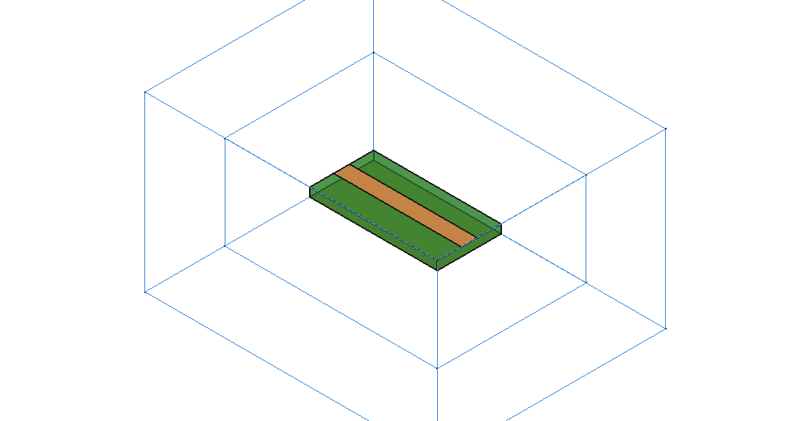
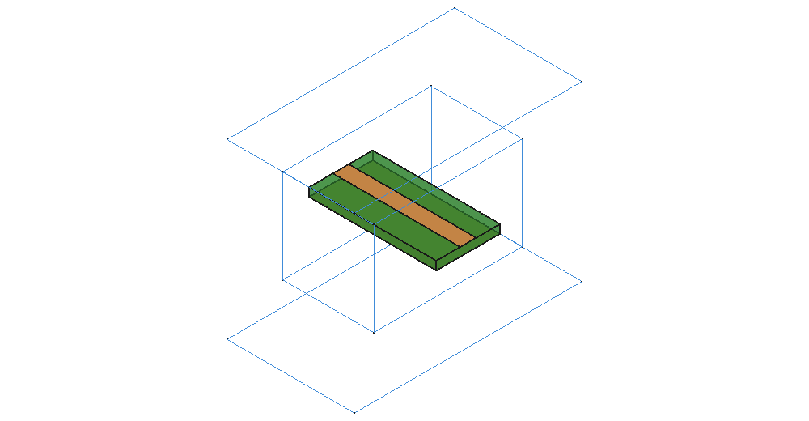
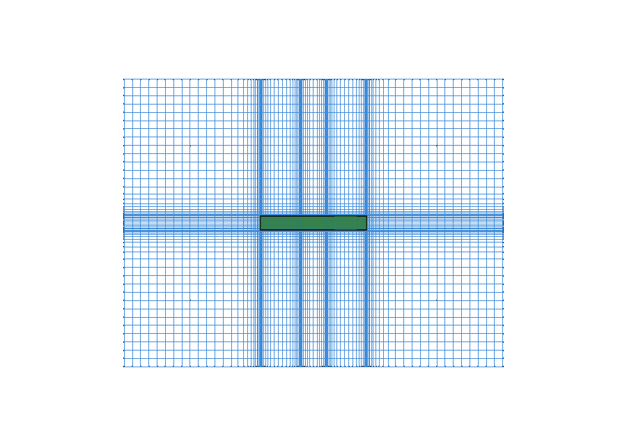

# Meshing

Mesh generation is described by these objects in the study:
1. **Mesh policy (solver-neutral)**: the problem every backend solves - what
   lies beyond the structure on each face of the domain, and a distance a
   curved surface may be solved from. One per study, so two backends solve one
   problem and their answers compare.
2. **Mesh Settings (openEMS)**: the orthogonal finite-difference grid the
   openEMS adapter lays - its density, a count across a dielectric, a floor
   under every cell - and the refinement regions that amend it.
3. **Mesh Settings (Palace)**: the same for the tetrahedral mesh Palace reads.

Where the two recipes ask for the same thing, they use the same property name.
The same number of elements gives a different accuracy on each backend, so
each recipe holds its own values, and a refinement region amends one of them.

The tree shows each solver over its mesh settings and the mesh made from them,
and each mesh settings over the regions amending them.

The workbench uses the generic term *element*. The openEMS adapter
generates rectangular Yee *cells*. The Palace mesher lays tetrahedra.

## Mesh Policy

The problem every backend of the study solves, in the unit it was stated in.
Each backend answers each property or states that it does not. [Mesh Settings
(Palace)](#mesh-settings-palace) says how each reaches the tetrahedral mesh.

<!-- defaults: EMMeshPolicy -->
| Property | Default | Description |
|---|---|---|
| `CurveTolerance` | 0 | Maximum allowed surface deviation on curved geometry in mm (0 = CAD default) |


### CurveTolerance

Controls surface triangulation resolution when exporting curved CAD bodies to
openEMS polyhedral representations.

- `0` (default): Uses the CAD kernel's standard triangulation deflection.
- Setting a positive value (in mm) enforces maximum chordal deviation between
  triangulated facets and true CAD curved surfaces.

On openEMS the translation report logs the mean surface deviation of each
curved body during Check and Run.

On Palace a `CurveTolerance` other than 0 is refused. The mesh carries the
curved surface in its elements.

### Simulation domain boundaries

Each domain face says what lies beyond the structure there, which is what
decides the boundary condition at the outer edge of the simulation volume:

<!-- defaults: EMMeshPolicy -->
| Property | Default | Description |
|---|---|---|
| `Boundary<axis><side>` | Open | What lies beyond the structure (`Open`, `Through` or `PEC Wall`) |
| `Clearance` | 0 | Distance from the structure to each `Open` face of the domain, in millimetres (0 = derived from the band) |
| `Medium` | empty | Dielectric that fills all space no bound body fills, out through the absorber (empty = vacuum) |

- **`Open`**: The medium runs on beyond the structure. On openEMS the absorber
  sits outside a layer of it `Clearance` deep. On Palace the medium is reserved
  `Clearance` deep, and its outer side carries a first-order absorbing
  condition. Use for radiating structures and antennas.
- **`Through`**: On openEMS the structure runs out through the absorber. This
  terminates transmission lines directly into the absorbing boundary without
  reflecting ends, effectively modeling an infinitely long transmission line.
  On Palace `Through` is refused on every face no port's own plane bounds: see
  below.
- **`PEC Wall`**: The domain stops where the structure does, and the face is a
  perfect wall. Use it on a face walled by a conductor, where nothing is
  measured outside the wall. On Palace a body that a `PEC Wall` or a `Through`
  side touches only where the body curves away from it is refused: see
  [Geometry on Palace](geometry.md#geometry-on-palace).

On openEMS the condition on each face follows from its `Boundary` and from
nothing else:

| `Boundary` | `Absorber` PML | `Absorber` Mur |
|---|---|---|
| `Open` | `PMLCells` of absorber beyond the air | Mur's condition on the face, beyond the air |
| `Through` | `PMLCells` of absorber over the structure's own outer cells | Mur's condition on the face, on the structure |
| `PEC Wall` | a perfect electric wall on the drawn face | the same |
| `PEC Wall`, with waveguide ports standing across the whole face | `PMLCells` of absorber beyond the ports' plane | refused |

A wall stands on the drawn face whatever the opposite face of its axis does: no
cell is laid beyond it. A waveguide port stands on a face where its plane lies
within a nanometre of it, and the cross-sections of several ports on one face
count together. The translation refuses, by name:

- A `PEC Wall` face that waveguide ports cover only in part. openEMS states one
  condition for a whole face, so the rest of the face would absorb where the
  policy says it is a wall, or a wall would stand behind the port. A guide drawn
  with metal walls reaches this, since the walls take part of the end face. Draw
  the guide as the air inside it, so the `PEC Wall` faces are its walls, or stand
  the port on a plane inside the guide and set the face to `Through`. The
  message states the area left uncovered.
- A waveguide port standing inside the guide with a `PEC Wall` face behind it. The
  guide behind the port is then a stub shorted at the wall. openEMS would solve
  the stub, and Palace, which ends the model on the port's plane, cuts it away,
  so the two backends would solve different devices. Set that face to
  `Through`, or stand the port on the end face.
- Mur on a `PEC Wall` face waveguide ports cover. The ports' sources lie on the
  face, and openEMS holds a Mur face shut while a source on it runs, which here
  is the whole run. Set `Absorber` to PML.
- A port whose plane lies in a `PEC Wall` face, other than waveguide ports
  standing across the whole face: a lumped port lying flat in it, or a
  microstrip port whose feed stands on it. The wall is a perfect conductor
  across the port, which shorts it. For a lumped port, set the face to `Open` or
  draw the port inside the structure. For a microstrip port, set the face to
  `Through` so the line runs out through the absorber, set it to `Open`, or
  raise `FeedOffset` so the feed stands inside the structure.
- A lumped port lying in a `Through` face. The line the port drives runs on into
  the absorber rather than ending on the port. Set the face to `Open`, or draw the
  port inside the structure.
- Room a dielectric body stands against that is thinner than 0.001 of the
  least extent of the bodies round it, such as two bodies drawn to meet that
  miss each other, where no body of the medium's own material closes it. Both
  backends would lay cells or elements that thin across it, and both refuse it
  by name. Where such a body does close it, both solve the body grown over the
  gap and say so (see
  [The room round the structure](#the-room-round-the-structure)).

How a face absorbs is the solver's own: see
[Absorber](running.md#absorber).

Palace builds no absorbing layer. On Palace, `Open` reserves the medium
`Clearance` deep beyond the face and puts a first-order absorbing condition on its
outer side: see [Open studies on Palace](#open-studies-on-palace).

`Through` is refused on every face no port's own plane bounds, because where such
a model ends the boundary carries a perfect wall and the wave the face was meant
to carry away is reflected whole. Which planes bound a face differs between an
open and a closed study, and the refusal says which:

- In either, a waveguide port standing across the face bounds it. The mesher
  leaves out what is behind the plane, so the model ends on the port and the
  port's own condition is what a wave meets there.
- In an **open** study a lumped port's plane also bounds the side of the reserved
  air it lies in. That plane is the whole side, the air beside the faces drawn
  there included, and outside the port's elements it is a magnetic wall.
- In a **closed** study there is no such side, so a lumped port bounds nothing.
  `Through` there wants a waveguide port across the face, or `Open`, which
  reserves the space that gives a lumped port's plane a side to lie in.





On openEMS, for `Through` faces, the outermost `PMLCells` of the model volume are
assigned to the absorbing boundary layer. Transmission lines extending
through these boundaries must remain uniform across the absorber depth.

### Clearance

How far the open surface stands from the structure on every face whose
`Boundary` is `Open`. It is a length, and the domain grows by exactly that length
whatever the grid's density. A face saying `Through` or `PEC Wall` reads none of it.

`0` derives it: 0.4 of the wavelength in the medium at `FrequencyStop`. That puts
the open surface the same share of a wavelength away at the top of every band,
so what it reflects of a radiated wave there is the same whatever the band.
It suits a circuit board, whose field is bound to the substrate. A radiator
wants more: at the bottom of its band the derived clearance is a smaller share
of the wavelength, and the absorber then stands in the near field. Type a
length for a radiator.

To close a face on the structure, set it to `PEC Wall`. A `Clearance` of 0
does not close it.

### Medium

`Medium` links the material that fills every space no bound body fills: the room
round the structure, the inside of a hollow part, a pocket, a guide drawn as its
walls, and the absorber beyond each `Open` face. Leave it empty for vacuum. Link a
`Dielectric` from the document, lossless or lossy, magnetic or not: a board
potted in resin, an antenna in water, a sensor buried in soil. A body drawn and
bound stands over the medium, so a capsule of air inside tissue is a box of air
bound to a vacuum material.

The medium is one material for the whole study. A `PEC`, a `Conducting Sheet` and a
`Frequency Dependent Dielectric` are refused by name, and so is a link to an object
that is not a material.

On openEMS the absorber beyond a face the domain ends on, which waveguide ports
cover, carries on the guide behind the ports' plane and stays vacuum.

Each backend meshes the medium at its own wavelength, and a `Clearance` of `0`
is derived from that wavelength. Before the run the log names the medium, its
values at the band and its wavelength at `FrequencyStop`.

Neither absorber carries a medium's loss. openEMS' perfectly matched layer and
Palace's absorbing condition are each matched to the medium's impedance without
its loss, so they reflect part of a wave that reaches them. Where the medium is
lossy the log states that share and how much of it comes back across the
clearance, at whichever end of the band returns more. A lossy medium also
absorbs what crosses it, so a larger clearance lowers both.

openEMS takes a cell conducting above 1000 S/m for metal and lays no absorbing
layer there. A medium that conductive is refused where any face carries the
perfectly matched layer. Set the solver's `Absorber` to `Mur`, or link a medium
that conducts less.

On Palace a `Clearance` typed on a study with no `Open` face lays nothing. The run
states that with the length it was given.

### The room round the structure

A study is open when its mesh policy sets `Boundary` to `Open` on at least one
face, and closed otherwise. Either way, every part of the domain that no bound
body fills is the study's medium, on Palace as on openEMS: vacuum, unless the
mesh policy's `Medium` links a dielectric (see [Medium](#medium)). The inside
of a hollow part, a cavity cut in the air, a pocket in a housing and the inside
of a guide drawn as its metal walls are the medium.

Room that metal, or the back of a waveguide port's face, closes off from the
model is left out of it on Palace. Its field is nothing: no port drives it, no
lumped element stands in it and no wave crosses into it, so leaving it out
changes no answer. The room between a housing and the box round the drawing,
the inside of a shell of metal and the stretch of a guide behind its port's
face are such room. Before the run, and in **Check**, the log names each room
it leaves out, where it stands, its volume and what closes it off. Room that a
dielectric body stands against, that a lumped port stands in, that a port faces
into or that reaches an `Open` face is kept. openEMS keeps such room, fills it
with the medium like any other, and with nothing to drive it the field there
stays nothing on openEMS too.

A gap thinner than 0.001 of the least extent of the bodies round it, beside a
dielectric body and reaching no `Open` face, is read as bodies
meant to meet that miss each other: a guide drawn as two bodies a micron apart,
or an insert a hair smaller than its pocket. Both backends would lay cells or
elements as thin as the gap across it. The thickness is twice the room's volume
over its surface: a slab's thickness, a hole's radius, a third of a cube's side.

Where a whole body of the medium's own material stands beside the gap and closes
it, the gap is that body grown: the room is the medium, and so is the body. Both
backends solve the body grown over the gap and say so before the run, naming the
body, the gap's thickness and where it stands. A body of vacuum is the medium's
material when the study links no `Medium`. A gap whose bounding box reaches a
port or a lumped element is never closed this way: on openEMS that is the port's
whole box, and on Palace the port's face or each rectangle a lumped port is laid
on.

Any other such gap is refused on both backends, for example the gap between two
blocks of a dielectric that is not the medium. The message names the bodies and
where the gap stands. Move the bodies to meet, or draw a body filling the gap
and bind the material meant there to it.

## Open studies on Palace

**What a study reserves.** The workbench builds a box round every shape bound to
a material, dielectric bodies and metal sheets alike. The box extends
`Clearance` beyond the structure on each `Open` face, and is flush with the
structure on each `PEC Wall` and `Through` face. Everything in the box that no
bound body occupies is the medium, and is the group `free space` in the mesh. A
part bound to no material is not in the box and displaces no air. The `Open`
sides of the box are the group `open boundary`, and carry a first-order
absorbing condition.

The box is measured to a bounding box round each shape that encloses it, taken
the same whether the 3D view has shown the shape or not. That bound is exact
for a face square to an axis and stands off a curved surface, so a clearance is
measured from the bound rather than from the body. The run states how far the
bound stands off the body where it stands off at all.

A `PEC Wall` side is a perfect conductor, over the whole side of the box. Where
another face is `Open` that side is wider than the drawing, so the wall stands
in the reserved air beyond the conductor the drawing holds. The field has to
meet something at the side, so this is the domain's own truncation rather than
a fault, and the run names each such side with the area of it the drawing does
not cover. Draw the conductor out to the edge of the air to make the whole wall
the drawing's, or set that face to `Open`.

A `Through` side is accepted only where a lumped port's rectangles lie in it.
There the whole side is a magnetic wall outside the rectangles, the air beside
the drawn bodies included, and the run states that air's area. The field a line
holds in the air meets that side squarely, and a magnetic wall ends the line
there as the port's plane does. A wave radiated onto that air is reflected. On
a `PEC Wall` side a lumped port's plane is the faces of the bodies drawn there,
and the air beside them is the wall.

The reserved air is a region of its own, so a study need not bind a dielectric
to anything. A radiator drawn as metal alone stands in the air, and a guide
drawn as its metal walls holds it. What an open study does need is air across
every axis it is flat along: the reserved air is a solid box, and a structure
drawn in one plane with neither face across that plane set to `Open` leaves the
box no thickness, which is refused by name.

A face of a body is a wall only where metal is drawn on it or where it lies in
a side of the box that is not `Open`. A shield, a cavity or a guide drawn as
its interior, with its walls left to the boundary, loses those walls wherever
the box holds air beyond them, whatever it is filled with. Draw the walls as
metal, or set `PEC Wall` on the faces of the study the walls lie toward.

The air is meshed at the element size in the medium, and each dielectric region
at its own. The edges of metal sheets are refined from the size in the slowest
region, as in a study whose drawing fills its box.

**What a study that reserves air states.** Before the run, and in **Check**,
the log states which faces are open, how far the open surface stands from the
structure in millimetres and in wavelengths in the medium at each end of the
band, and how many times the smallest extent of the thinnest drawn body that
distance is. At the bottom of the band it states the reflections below and names
the larger. One is what the first-order condition reflects of the dipole mode,
which falls as the surface stands farther off. The other is what a flat side
reflects of a plane wave meeting it at the steepest angle a straight line from
the structure meets an open side at, which no distance lowers. Neither is a
bound, and neither applies to the field a transmission line holds near its
cross-section. Where air stands beside a lumped port's face on a `Through`
side, the log says that air is a magnetic wall and that neither figure counts
what it reflects.

The statement about a region's own faces is made face by face, in open and
closed studies alike. For each region, the log names every face of it that
stands in the reserved air with no metal on it - where it stands, its area, and
which face of the study it lies toward. Metal drawn over one face does not
silence the next: a board's substrate is named on the faces its ground and its
trace leave bare, as a shielded line is named on the side walls nobody drew.
The remedy is the same either way: draw metal on the face, or set the `Boundary`
it lies toward to `PEC Wall`, which keeps that side of the box flush with the
structure and walls it.

After the run, the log states for each driven port the share of the power that
left through the open surface, and an estimate of how far the surface moved the
port's column of the matrix: the larger of those reflections at each
frequency, times the root of the port's share and the largest share any driven
port sent through the surface. The estimate is taken at the frequency where it
is largest. A port not driven sends a share nobody measured, and its terms are
not estimated. The dipole mode's figure alone can understate the move where the
open surface cuts through the field a transmission line holds. The estimate
takes the larger figure, so it is never below the dipole mode's,
and it is looser where the slanted wave's figure decides it.

The balance line states the share the ports do not get back, the share that
left through the open surface, and the rest, which is the solver's error where
nothing dissipates and the heat together with it where the model does: see
[Lumped ports on Palace](ports.md#lumped-ports-on-palace). A run that accounts
for more power than went in by more than a tenth of a percent is directed to
refine the mesh at the open surface, where a coarse mesh reads the flux high.

A stored result of an open study records its outside in its `Modelled`
property: the order of the condition, the sides it stands on and the clearance.
A result of a closed study records none.

**What a study that reserves air refuses.** A waveguide port in an open study
is refused by name: this solver takes an open study through lumped ports only.
An object labelled `free space` or `open boundary` is refused in a study that
reserves air, because the mesh uses those names for the reserved air and its
open sides. A lumped port's rectangle lying in a side of the reserved air where
no body bound to a dielectric is drawn is refused.

[The open boundary on Palace](internals/palace-open-boundary.md) explains the
order of the condition and the two figures.

## Mesh Settings (openEMS)

The grid the openEMS adapter lays for the problem the policy states.

<!-- defaults: EMYeeGrid -->
| Property | Default | Description |
|---|---|---|
| `ElementsPerWavelength` | 20 | Target cells per wavelength in the slowest medium in the model (highest `epsilon_r * mu_r`) at `FrequencyStop` |
| `EdgeRefinement` | 6 | Refinement factor for cells adjacent to conductor edges |
| `MaxGrowthRatio` | 1.3 | Largest size ratio between adjacent cells of the grid |
| `MinElementsAcross` | 9 | Minimum cell count across dielectric thickness |
| `MinElementSize` | 0 | Minimum allowed cell size in millimetres (0 = automatic) |

Element sizing is defined relative to electrical wavelength rather than fixed
millimetre dimensions, automatically adapting resolution when frequency or
substrate permittivity changes:

```
lambda_min          = wavelength(slowest_dielectric, FrequencyStop)
bulk_cell_size      = lambda_min / ElementsPerWavelength
conductor_cell_size = bulk_cell_size / EdgeRefinement
```

### MinElementsAcross

Enforces a minimum cell count across the thickness of solid dielectric
substrates. openEMS uses volume-averaging for dielectrics, and thin substrates
require multiple grid planes to represent the internal vertical field
gradient accurately.

Conductors are excluded from this rule; thin conductor foils are modeled as
zero-thickness `Conducting Sheet` elements, or spanned by a single cell with
both faces pinned to grid planes.

### MinElementSize

Defines an absolute minimum cell size floor (in millimetres) to prevent
unintentional geometry slivers (e.g. from boolean operations) from forcing
extremely small timesteps in FDTD simulations.

The translation refuses a floor above the cell a conductor's edge is meshed at,
since the floor would then override the resolution it protects. The message
states that cell. Lower `MinElementSize` below it, or lower
`ElementsPerWavelength` or `EdgeRefinement` until the edge cell is coarser than
the floor.

Keep `MinElementSize` at 0 unless diagnosing mesh issues.

### EdgeRefinement

Conductor edge refinement is critical for planar transmission lines because
electromagnetic fields exhibit singular behavior at sharp metallic edges.
Under-resolving conductor edges alters extracted characteristic impedance.

- Setting `EdgeRefinement` to 1 sets target conductor edge cells to the bulk
  element size. Narrow conductors may still be refined further to maintain
  the minimum conducting width.
- Values less than 1 are rejected during validation.
- Refined grid lines are placed along conductor edges to resolve fringing
  fields.

For curved conductors, grid resolution scales with surface radius of
curvature. `EdgeRefinement` sets the lower bound on cell size for this
refinement. In addition, curved conductor boundaries are expanded outward by
0.5 Yee cells to compensate for discretization offset (see [Drawing the
device](geometry.md#where-a-curved-conductor-ends-up)).

## Mesh Refinement regions

Refinement regions define localized cell sizing for critical geometric
features (such as coupling gaps, tight inter-trace spacing, or resonant
notches). A region amends one backend's mesh settings, and only that backend
meshes with it. The same place refined for both backends is two regions, each
sized for its own mesh, and the tree shows each under the mesh settings it
amends.

Select the geometry and click **Add Mesh Refinement**. In a study holding two
solvers, select as well the solver the region is for, its mesh settings, its
mesh or one of its regions; the command refuses a selection naming neither
backend or both. In a study holding one solver the region amends that solver's
mesh settings.

<!-- defaults: EMMeshRegion -->
| Property | Default | Description |
|---|---|---|
| `MeshSettings` | selection | The mesh settings this region amends |
| `References` | selection | Target geometric bodies or faces |
| `Mode` | Refine | Refinement direction (`Refine` to decrease cell size, `Coarsen` to increase) |
| `ElementSize` | 0 | Target element size in millimetres |
| `MinElementsAcross` | 0 | Minimum elements across region extent (0 = inherit from `MeshSettings`) |
| `Enabled` | true | Toggles region active status |

- `Refine`: Asks for elements no larger than `ElementSize` at the selected
  geometry. The openEMS grid refines every line across the bounding box of
  each selected shape. The Palace mesh sizes the shape itself and grows away
  from it.
- `Coarsen`: Allows non-critical bodies (such as mechanical brackets or
  housings) to use coarser cells up to the global bulk limit on the openEMS
  grid. The Palace mesh coarsens only the edges of metal whose binding the
  coarsening names whole; see [Mesh Settings (Palace)](#mesh-settings-palace).
  Both refuse a coarsening naming geometry no material binding names, since
  nothing there has a size of its own to settle for.

Each backend refuses, by name, a region whose `MeshSettings` is empty, which is
what deleting the mesh settings alone leaves, and a region amending the mesh
settings of another study. Deleting a solver deletes the regions amending its
mesh settings with them.

---

## How the grid is laid (openEMS)

The openEMS adapter constructs a non-uniform rectilinear Yee grid along each
Cartesian axis independently:



### 1. Fixed positions (Anchors)

Critical geometric planes are pinned to exact grid coordinates:
- Zero-thickness planar sheets (`Conducting Sheet`).
- Solid conductor faces where no edge treatment applies: metal continuous
  through the plane, metal on both sides of it, or a face at a domain
  boundary. An isolated conductor edge instead receives a pair of lines
  straddling it, with none on the face.
- The plane of a lumped port drawn flat across an axis, whether the port is
  driven or not, and a waveguide port's two planes. Every run of a study
  shares one grid, so the port each run drives already has its line, and a
  device that is its own mirror image is meshed as one.
- Domain boundaries.

Dielectric boundaries are treated as preferences; openEMS volume-averages cut
cells across dielectric interfaces.

### 2. Sizing field and placement

The mesher generates a continuous 1D sizing field along each axis, bounding
cell size transitions to `MaxGrowthRatio`. Grid lines are positioned by
integrating along the sizing field, ensuring smooth gradation.

### 3. Symmetry enforcement

The mesher evaluates whether pinned geometric anchors and the 1D sizing
field mirror symmetrically about the domain center along each Cartesian
axis. When geometric symmetry is present, the mesher automatically folds the
grid onto its mirror image to prevent numerical mode asymmetry. This check is
computed directly from the geometry and sizing field, independent of the
analysis symmetry property.

### 4. Memory budget guards

To prevent memory exhaustion, the mesher estimates the RAM required for
openEMS field arrays prior to building. Grids exceeding line or memory
thresholds are rejected during validation.

---

## Mesh Settings (Palace)

The tetrahedral mesh Palace solves the problem the policy states on.

<!-- defaults: EMGmshMesh -->
| Property | Default | Description |
|---|---|---|
| `ElementsPerWavelength` | 4 | Target elements per wavelength in the slowest medium in the model at `FrequencyStop` |
| `EdgeRefinement` | 8 | How many times smaller than bulk the elements are at the sharp edges of metal |
| `ElementsPerTurn` | 6 | Elements per full turn of a curved surface, where that is finer than `ElementsPerWavelength` asks (0 = size by the wavelength alone) |
| `MaxGrowthRatio` | 1.6 | How much the element size grows per element away from a refined place. Adjacent tetrahedra also differ by their shape, so the ratio between two of them is not this number |
| `MinElementsAcross` | 9 | Fewest elements across the thickness of each dielectric. The run does not lay this count, and reports it beside the element size reached |
| `MinElementSize` | 0 | A floor under every element size in millimetres (0 = derived) |

`ElementsPerWavelength` is lower than the Yee grid's because an element carries
a polynomial of the solver's `Order` across itself, where a Yee cell carries a
constant. To check that an answer has stopped moving, solve it again finer: see
[Checking how far the answer depends on the
mesh](#checking-how-far-the-answer-depends-on-the-mesh).

`EdgeRefinement` and `MaxGrowthRatio` act together, and the Yee grid has
neither. The mesher asks for a rim at the bulk size divided by
`EdgeRefinement`, and grows back to the bulk size over a ramp as wide as that
difference divided by `MaxGrowthRatio` less one. The elements in that ramp are
the cost of the refinement. The growth coarsens the element standing on the
rim whatever the size along the rim, so a steeper growth with a finer size
resolves the rim as well over a narrower ramp. Raise `EdgeRefinement` to spend
more at a rim, and lower `MaxGrowthRatio` toward 1 only where the elements a
short way off the rim matter in their own right.

A narrow sheet of metal gets a count across it as well. Where two free edges of
sheets of metal face each other across a sheet, or across a gap in one or
between two, closer than four times the size at the rim, each of the two is laid
at the distance between them over four. The two edges of a strip carry the field
the strip's impedance is set by, and one element between them leaves the line
under-resolved. The size grows back from the two edges as from a rim, and the
run states each edge laid this way, with the size asked and the size reached.

Two edges face each other where they run side by side, the line across from one
to the other stands within half a right angle of square to both, and the two lie
on one face or in one plane. The side of a wide section and the side of a narrow
one stepping in from it do not face each other, and neither do two sides meeting
at a corner, two edges on two layers of metal, or two sides of an outline joined
by a third that the line would run along. A section shorter than it is wide is
narrow along its length, and its two ends face each other. Two edges that touch
face nothing, so a sheet whose sides meet at a point, or whose outline is one
closed edge, is not counted there, and neither is a gap between two faces that
meet at an angle. To refine those edges, add a Mesh Refinement on them.

An edge lying along other metal or along a side of the box the model ends on,
over its whole length, is not counted. The plane a lumped port's element lies
in is a magnetic wall outside the element, which reflects the model: an edge
lying in it is not counted, and an edge facing its own reflection across the
plane is counted against it, so half a strip drawn against the plane is counted
across the whole strip's width.

The count is asked of sheets alone. A body's faces include its thickness, so a
body drawn as a strip is stated with its width and the count the rim leaves
across it, and nothing is laid. A Mesh Refinement on the body's edges lays a
finer size there. A Mesh Refinement set to Coarsen that names the metal whole
settles these edges as it settles the rim, and the run says which edges carry
fewer than four across. With `EdgeRefinement` 1 nothing is laid, and the run
names each narrow section and the count of elements across it. On openEMS the
grid's width rule still refines a narrow conductor at `EdgeRefinement` 1. Where
the floor under every element, which `MinElementSize` sets or derives, is
coarser than the size at the rim, the floor holds the narrow edges as well, and
the run says how fine a `MinElementSize` lays four across.

Palace is meshed by Gmsh into tetrahedra. An element size on tetrahedra is the
same along every axis, and a size asked for at a place makes the elements
there finer and never coarser. Each property reaches the mesh as follows:

| Property | On the tetrahedral mesh |
|---|---|
| `ElementsPerWavelength` | The element size everywhere in the model |
| `MinElementSize` | A floor under every element size. 0 derives it: a hundredth of the element size in the slowest material. A rim or a refinement region asking for a size below it is laid at the floor, and the run states it. A negative floor is refused, and so is a floor at or above the largest element the band and `ElementsPerWavelength` allow |
| `ElementsPerTurn` | The element size on each curved surface and curve of the drawing: a full turn at its sharpest curvature at that point holds this many elements, where that is finer than the size everywhere. On a surface the size is one length at each point, so a thin wire is meshed at its radius along its whole length. 0 lays nothing |
| `EdgeRefinement` | The element size along each edge of metal bound to `PEC` or `Conducting Sheet` that the room turns round by more than half a turn, including an edge on the boundary of the model, and the count across a narrow sheet above. 1 lays neither. Values less than 1 are refused |
| `MaxGrowthRatio` | How fast a finer size at a rim or in a refinement region grows back to the size everywhere. Required above 1 where either is laid |
| `MinElementsAcross` | Not laid. A count across a thickness would fill the whole body at that size. The run states it for each region, with the size of the region's elements and the smallest side of the box round it |
| `CurveTolerance` | Refused. The mesh carries the curved surface in its elements |
| `Boundary` | `Open` reserves the medium `Clearance` deep beyond the face, meshed at the size in the medium, with a first-order absorbing condition on its outer side. `Through` is refused on any face no port's own plane bounds, since the boundary there carries a perfect wall. `PEC Wall` walls the whole side of the reserved air, which is wider than the drawing wherever another face is `Open`, and the run states that side's area |
| `Clearance` | How far the open surface stands from the structure on each `Open` face. In a study with no `Open` face it lays nothing, and the run states it |

A second-order element follows a curved surface only across a limited arc, and
one laid across a tighter curve is turned inside out. `ElementsPerTurn` sizes
each curved surface by its radius for that reason: a wire, a pin, a via, a
fillet or a ring thinner than the size everywhere is meshed at a share of its
own radius. The floor stops the size where the curvature grows without bound,
at the apex of a cone and along a knife edge. A thin round body costs its
elements along its whole length, and the run reports the shortest element
edge of each labelled part. Where that cost is not wanted, draw the body
square, or set `ElementsPerTurn` to 0.

Where Gmsh cannot lay elements over part of the drawing, the run stops with
what Gmsh said. It names each label holding elements turned inside out and each
region left empty, with where they are, and where Gmsh says which surface it
stopped on, the labels on either side of it. A part that curves or narrows
tighter than the elements laid there is filled by finer ones: raise
`ElementsPerTurn`, set `MinElementSize` below the floor, or lay a `Mesh
Refinement` on the part with an `ElementSize` near its smallest radius or
width. Where Gmsh cannot cut the drawn shapes against each other, the run names
the labels whose shapes were being cut, and the element size changes nothing.

A `Mesh Refinement` set to `Refine` lays its `ElementSize` at each thing it
references: along a face, an edge or a vertex, and throughout a body, growing
back at `MaxGrowthRatio` away from it. The shape is cut into the mesh and
claims nothing of it, so the space a curved shape goes round, such as the inside
of a ring, is meshed at the size everywhere. A face the shape crosses is cut
into pieces and stays what it was: a waveguide port whose face a region crosses
keeps the line its voltage is read along. A vertex or an edge standing inside a
body is not something the body is meshed round: the elements there follow the
size asked, and have no corner on it. `ElementSize` at or above the size
everywhere lays nothing and is stated. `MinElementsAcross` on a region is not
laid and is stated.

A `Mesh Refinement` set to `Coarsen` is laid at the edges of metal bound to
`PEC` or `Conducting Sheet` where the coarsenings name every face the binding
names. Bindings of `PEC` bodies that meet are one metal (see
[Overlaps](geometry.md#overlaps)), and it is coarsened only where the
coarsenings name every face each of those bindings names. The edges are refined
to the coarser of `ElementSize` and the size `EdgeRefinement` asks for, and not
at all where that is at or above the size everywhere. The run states the length
of the metal's edges and how near they come to another conductor, since a gap
there is meshed as the edges are; openEMS keeps such a gap at its own size. A
coarsening naming some of those faces, or geometry a dielectric is bound to, is
not laid and is stated. One naming geometry no binding names is refused, as it
is for openEMS.

`EdgeRefinement` refines an edge where the field is singular: where the room
the model holds turns round the edge by more than half a turn. The run's report
calls such an edge a free or re-entrant edge. Where the room
opens round the edge of a perfectly conducting wedge by an angle `alpha`, the
field goes as `r^(pi/alpha - 1)`, with `r` the distance from the edge. The
power is negative, and the field grows without bound toward the edge, where
`alpha` is more than `pi`, half a turn. So the free edge of a sheet, a
step, the edge of an iris and the outside of a fold are refined, and a guide's
inner corners, a flat seam, an edge where two faces meet tangentially and metal
meeting metal are not. The same holds for a sheet and for a body bound to a
conductor, so a guide drawn as a housing of metal is meshed as the guide drawn
as its air. The rest of the boundary is the sides of a box, which the room
stands inside, so none of its creases is refined. Room nobody bound is the
study's medium, so an iris is drawn as metal: a notch cut out of a body of air
is filled with the medium like the rest of the box.

What ends the room round an edge is metal, on each side it has room, and the
boundary of the model. A dielectric's face and the plane a port lies in inside
the model do not end it. Where the room ends on a magnetic wall, such as the
plane of a lumped port outside its elements, the room past the wall is its
reflection and is counted with it. An edge is refined where the room opens round
it by more than a degree past half a turn, anywhere along it: an edge where two
curved faces meet at an angle that changes along it is refined whole where any
part of it is.

A rounded edge is not refined, however small its radius, since the room turns
round it by half a turn; a `Mesh Refinement` on it sizes it. A corner where
edges meet is refined only as far as the edges meeting at it are.

The run reports, before Palace starts, how many elements fill the model and
how many of them each region holds, the shortest and longest element edge of
each labelled part, and for each rim and each thing a refinement names the size
asked for, the figure the mesh answers it with, and the median longest edge of
the elements touching it with their share of the model. For each rim it also
states how many edges of the metal are neither free nor re-entrant, which carry
nothing. The figure is the
longest element edge along a rim or on a refined face, the longest edge of the
elements at a refined vertex or at an edge inside a body, and the median mean
edge of the elements in a refined body. The share counts the layer of elements
on the place, and not the growth round it: what a rim costs is the difference a
`Coarsen` region on its binding at the size everywhere makes to the count.

The elements touching a refined place are coarser than those along it, and
coarser the steeper `MaxGrowthRatio`: a tetrahedron is sized from the edges of
the surface it stands on, and grows away from the place as the growth allows. A
steep growth leaves even the place itself coarser than asked, and the figure
beside the size asked shows it. Read that figure to see the size laid.

---

## Inspecting the mesh

Press **Mesh**, on the toolbar or in a solver's panel. On openEMS it lays the
grid and draws it in the 3D view as `Mesh (openEMS)`, under the openEMS solver
in the tree, beside its mesh settings.

On Palace, **Mesh** meshes in the Palace panel. The mesh goes into the study as
`Mesh (Palace)`, FreeCAD's own FEM mesh object, under the Palace solver in the
tree, beside its mesh settings. Its groups carry the labels of the bindings and
ports (see [Running](running.md#palace-task-panel)). What the run reports about
the mesh is described under [Mesh Settings (Palace)](#mesh-settings-palace).

### Preview display modes (openEMS)

| `Display` mode | Description |
|---|---|
| `Outline` | Displays domain and PML absorber bounding boxes |
| `Slices` | Displays 3 orthogonal planar mesh cuts showing cell grading |
| `Anchors` | Displays pinned geometric boundary planes |

### Mesh report (openEMS)

The summary **Mesh** writes to the report view on openEMS provides:
- Total Yee cell count and line count per axis ($N_x \times N_y \times N_z$).
- Smallest and largest cell dimensions across the model, with axis.
- Worst-case cell growth ratio.
- Element counts across each defined body.
- PML absorber depth.

### Checking how far the answer depends on the mesh

Select a run and press **Solve Again One Step Finer**. The study is solved
again one step finer on the backend that solved the run, and the new run's log
says how far each term moved. A small move does not show that the answer has
converged: an answer both steps get wrong alike moves little as well. See
[Results](results.md).

To step by hand, raise `ElementsPerWavelength` or `EdgeRefinement` on the mesh
settings, or `Order` on the Palace solver, and run again.

### Conductor width preservation (openEMS)

Point-sampling on a rectilinear Yee grid snaps conductor edges to the nearest
Yee cell edge. For narrow microstrip traces, this discretization can reduce the
effective conducting strip width by up to $2/3$ of a grid cell.

The mesher automatically calculates the required face cell size so that at
least 95% ($19/20$) of the drawn conductor width remains electrically
conducting. This sizing is derived algebraically from conductor dimensions,
maintaining consistent transmission line characteristic impedance.

Pre-flight checks evaluate the generated grid and emit a warning if any
conductor falls below this 95% threshold. Conductors explicitly coarsened by an
`EMMeshRegion` are exempt from this warning.

